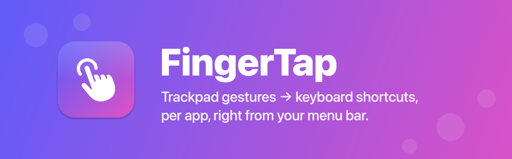

<p align="center">
  
</p>

<p align="center">
  
  
  
</p>

**FingerTap** is a tiny menu bar app that turns multi-finger trackpad gestures into keyboard shortcuts,
configured app by app.

- **Gestures**: double tap and swipe up / down / left / right, with 3, 4 or 5 fingers.
- **Per app**: the same gesture can close a tab in Chrome and run a build in Xcode.
- **Any keyboard layout**: shortcuts are recorded by physical key, so AZERTY, QWERTY… all work.
- **Conflict hints**: warns when macOS already uses a gesture (Mission Control, App Exposé, Look Up…).
- **Speaks your language**: English and French, following the Mac's language.

Out of the box, in Google Chrome: 3-finger swipe down closes the tab (⌘W), swipe up hard-reloads (⇧⌘R).

## Install

```bash
./scripts/build-app.sh
open dist/FingerTap.app        # or copy it to /Applications
```

1. Click the ✋ icon in the menu bar, then **Grant Access…**: macOS asks for the **Accessibility**
   permission, needed to send shortcuts. Reading the trackpad needs no permission.
2. Open **Settings…**, add an app with **+**, pick a finger count, click **Record Shortcut**
   next to a gesture and type the shortcut. Escape cancels.

## How it works

| Part | Role |
| --- | --- |
| `Sources/MultitouchBridge` | Loads Apple's private `MultitouchSupport` framework with `dlopen`. It is the only way to read trackpad touches outside one's own windows (BetterTouchTool, Jitouch and MiddleClick use it too). |
| `Sources/FingerTapCore` | Gesture detection (taps, double taps, swipes) and the per-app configuration. Covered by `swift test`. |
| `Sources/FingerTap` | Menu bar app, settings window, shortcut sending with `CGEvent`. |
| `scripts/make-art.swift` | Draws the app icon and this banner. |

Trackpad reading restarts when the Mac wakes or a trackpad is connected.

## Limits

- Relies on a private framework: a macOS update could break it.
- Ad-hoc signed: after each rebuild, macOS sees a new app. Remove FingerTap from
  **System Settings › Privacy & Security › Accessibility** and allow it again.
- FingerTap only listens. When macOS also uses a gesture, both happen: turn the system one off in
  **System Settings › Trackpad › More Gestures**.
